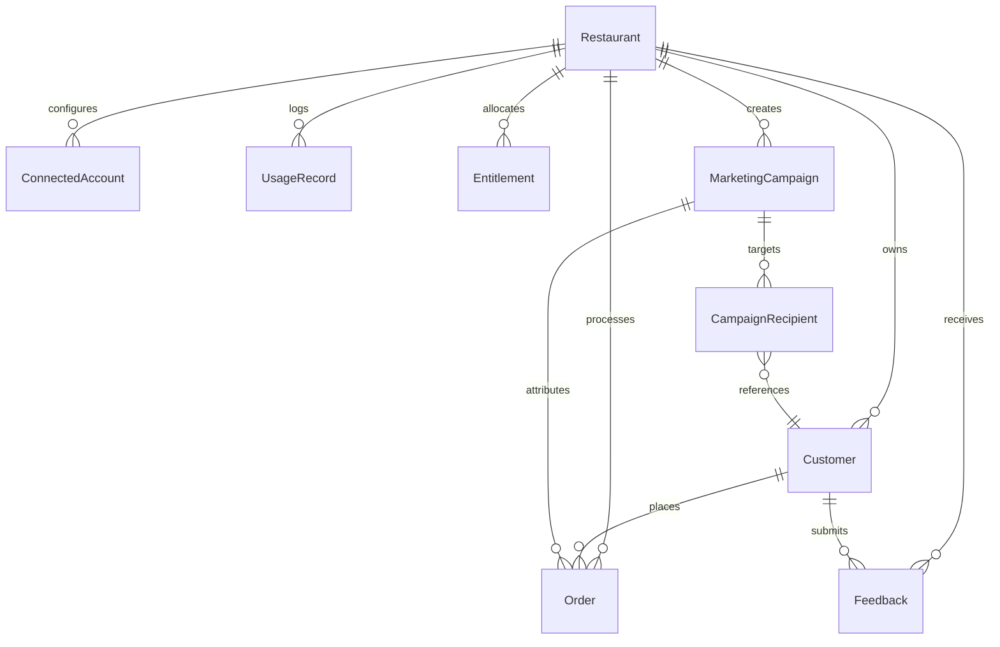

# ZapNowQR Dependency Map: FEATURE-001
**Role:** `principal_code_analyst`  
**Feature ID:** `FEATURE-001` (ZapNow Retention & Growth Engine MVP)  
**Date:** 2026-09-28  
**Scope:** Structural & Dependency Relationship Mapping

---

## 1. System Dependency Topology

```mermaid
graph TD
    subgraph Frontend [Frontend Layer - React 19 / Vite]
        A[AdminDashboard.tsx] --> B[MarketingPage.tsx]
        B --> C[MarketingOverviewTab.tsx]
        B --> D[CampaignsTab.tsx (New)]
        B --> E[WalletTab.tsx (New)]
        B --> F[ReviewsTab.tsx (New)]
        C --> G[marketingApi.ts]
        D --> G
        E --> G
        F --> G
    end

    subgraph Backend [Backend Layer - Node.js / Express 5]
        G --> H[marketingRoutes.ts]
        H --> I[marketingAuth.ts]
        I --> J[retentionController.ts (New)]
        I --> K[walletController.ts (New)]
        I --> L[feedbackController.ts]
        
        M[server.ts] --> N[retentionCohortScheduler.ts (New)]
        N --> J
        
        O[webhookRoutes.ts] --> P[whatsappWebhookController.ts (New)]
        O --> Q[razorpayWebhook.ts]
    end

    subgraph Database [Database Layer - Prisma ORM 5.22 / PostgreSQL]
        J --> R[(Customer)]
        J --> S[(Order)]
        J --> T[(MarketingCampaign (New))]
        K --> U[(UsageRecord)]
        K --> V[(Entitlement)]
        P --> W[(Feedback)]
        P --> U
    end

    subgraph External [External Third-Party Services]
        J --> X[Meta WhatsApp Cloud API v21.0]
        K --> Y[Razorpay Orders API]
        P --> X
        Q --> Y
        P --> Z[Google Maps Review Deep-Link]
    end
```

---

## 2. Component Dependency Matrix

| Component | Upstream Dependencies | Downstream Consumers | Coupling Level |
| :--- | :--- | :--- | :---: |
| **`MarketingPage.tsx`** | `react-router-dom`, Lucide icons, `AdminDashboard.tsx` | `MarketingOverviewTab.tsx`, `WalletTab.tsx`, `CampaignsTab.tsx` | Low |
| **`marketingRoutes.ts`** | `express`, `requireMarketingAuth` | `retentionController.ts`, `walletController.ts`, `app.ts` | Medium |
| **`retentionController.ts`** | `prisma`, `whatsAppService.ts`, `logger` | `marketingRoutes.ts`, `retentionCohortScheduler.ts` | Medium |
| **`walletController.ts`** | `prisma`, `razorpay.service.ts`, `logger` | `marketingRoutes.ts`, `razorpayWebhook.ts` | Medium |
| **`whatsappWebhookController.ts`**| `crypto`, `prisma`, Socket.IO `getIO()` | `webhookRoutes.ts`, `Feedback` table | Low |
| **`retentionCohortScheduler.ts`** | `prisma`, `whatsAppService.ts`, `server.ts` | Periodic background loop | Low |

---

## 3. Database Entity Dependencies



---

## 4. External Integration & Network Dependencies

1. **Meta WhatsApp Cloud API (`graph.facebook.com`):**
   * *Protocol:* HTTPS REST (Port 443).
   * *Direct Dependency:* Requires outbound network connectivity from the Node.js backend.
   * *Inbound Dependency:* Public webhook accessibility on `/api/webhooks/whatsapp` with valid SSL.
2. **Razorpay Payment Gateway (`api.razorpay.com`):**
   * *Protocol:* HTTPS REST.
   * *Direct Dependency:* Existing `razorpay.service.ts` client.
   * *Inbound Dependency:* `POST /api/webhooks/razorpay` for capturing UPI payments.
3. **Google Place Review URL:**
   * *Protocol:* Dynamic URL generation (`https://search.google.com/local/writereview?placeid={place_id}`).
   * *Direct Dependency:* None (client-side redirection only; no direct server-to-server dependency).
